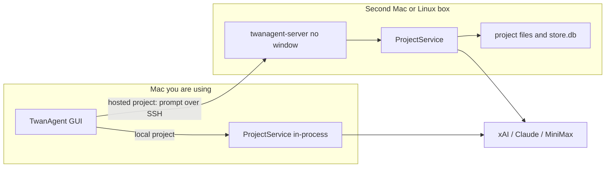
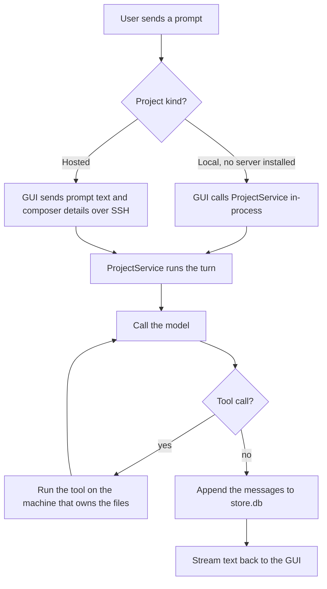
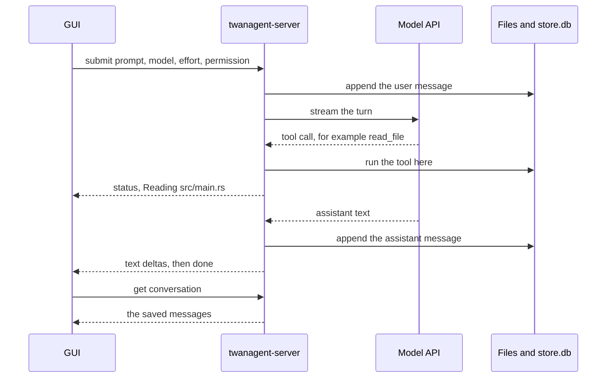
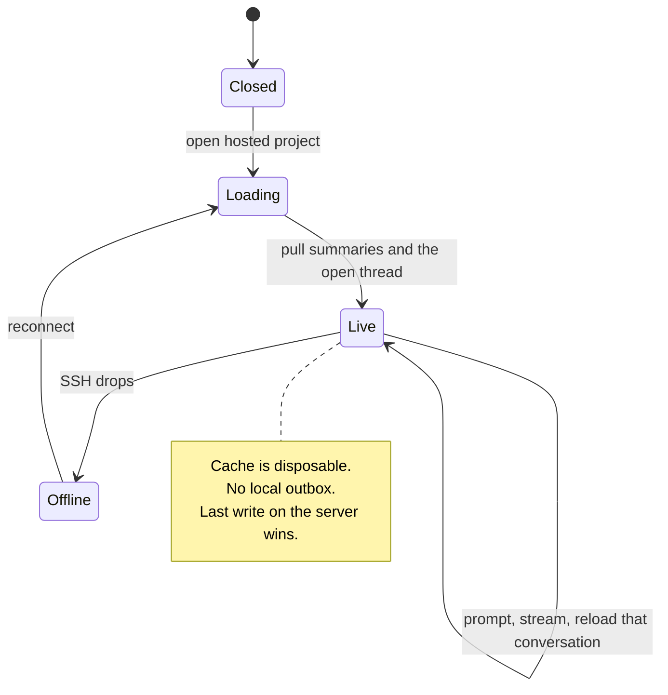
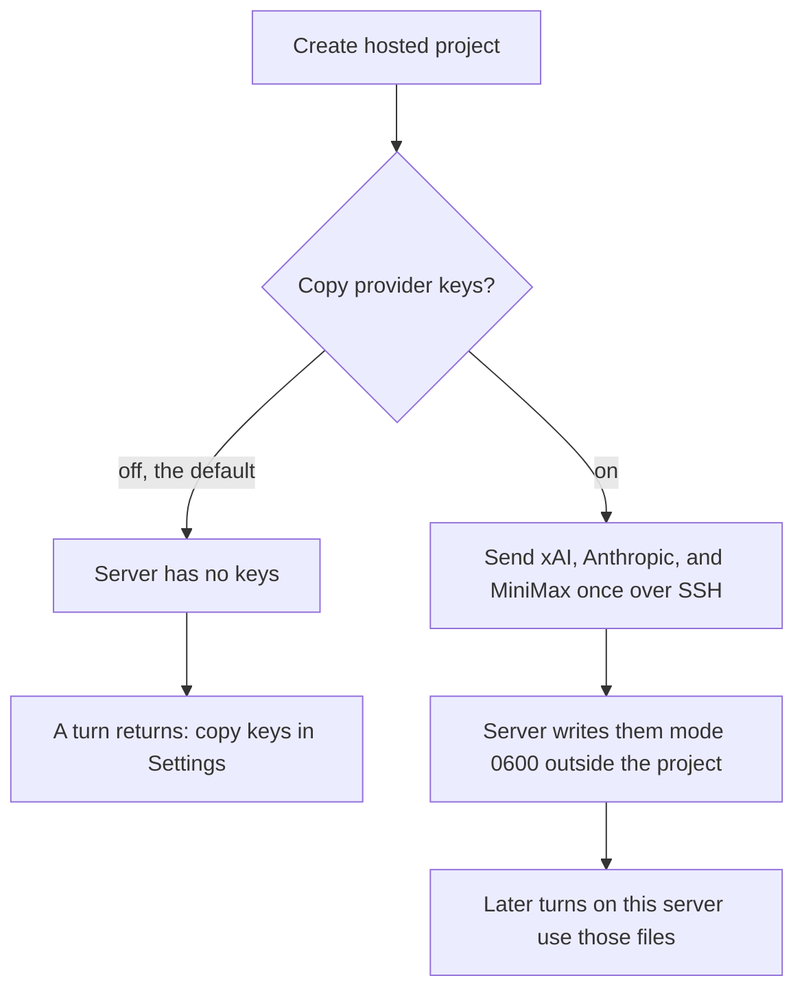

# Hosted agent implementation plan

> **For agentic workers:** Implement task-by-task with TDD. Do not commit unless the user asks. Do not start a task until the user accepts this plan.

**Goal:** A project on a second Mac or a Linux box keeps its files and its conversations there. The GUI sends only the prompt. The server runs the turn, the tools, and the transcript. The same engine runs inside the GUI when no server is installed, so local projects keep working with no extra process.

**Architecture:** One `ProjectService` owns files, `store.db`, and the agent loop. The Tauri app calls it in-process. `twanagent-server` is a headless binary with no window that calls the same service and speaks SSH. The GUI never executes tools for a hosted project. It submits a prompt and renders the stream the server sends back.

**Tech Stack:** Tauri 2, Rust (`russh`, `rusqlite`, `reqwest`), React, cargo test + node:test. No second chat implementation. No public listen port.

## Decisions

- The GUI-only install stays complete. Local projects do not require `twanagent-server`.
- A hosted project is created on the server. The project folder and `store.db` are created there. The client stores a pointer (machine id, project id, remote path), not a second source of truth.
- The server owns a running conversation. The client sends prompt text plus the details needed to place it: project id, conversation id, model, effort, context window, permission. It does not send tool calls, and it does not run `read_file`, `write_file`, `run_command`, or git for that turn.
- Tool execution, model HTTP, and the saved transcript happen on the machine that owns the project. Locally that machine is this Mac, in-process. Remotely it is `twanagent-server`.
- The client syncs conversations and messages from the server. A local cache may paint the sidebar before the round trip. It is disposable. Reconnect pulls again. The client does not merge a divergent transcript back.
- Provider keys move only when the user turns on "Copy provider keys to this server" during setup. Default is off. Off means a hosted turn cannot start until keys are copied. The GUI does not fall back to calling the model itself.
- v1 copies API keys only (xAI, Anthropic, MiniMax). It does not copy Claude OAuth or `grok login` sessions.
- The server is macOS and Linux, no UI. A second MacBook needs Remote Login, not the TwanAgent app.
- SSH is the only door. The desktop already trusts the host key and the login. The server does not listen on its own port.
- Existing SSH projects that only have files on the server and chats on this Mac keep that behavior until the user moves them. New hosted projects use the server from the start.
- Do not commit unless asked. No release unless asked.

## Current code

Today the split is the opposite of this feature.

- The agent loop is `completeTurn` and `executeTool` in `src/lib/agent.ts`. After each model chunk, the GUI runs tools through Tauri (`readFile`, `writeFile`, `runCommand`, git) and appends the tool results itself.
- Rust only streams one model HTTP call. `dev_chat_start` in `src-tauri/src/dev/chat.rs` emits `dev-chat` and returns. It does not run tools or save the conversation.
- Conversations are local. `dev/conv.rs` opens `store.db` under app data via `conv_store_dir`. `docs/test-conversations-on-servers.md` says the chat for a remote project is stored on this Mac.
- Files, git, and `dev_run_command` already branch on `remote::project_for_workspace` and run over the SSH pool (`src-tauri/src/dev/commands.rs`, `src-tauri/src/remote/exec.rs`). `mount_path` is a local id. The folder under `mounts/<id>` is empty. sshfs is gone.
- Machines, remote projects, and host keys already exist (`appdb.rs`, `remote/config.rs`, `remote/ssh.rs`). Secrets for SSH live in the keychain (`secrets.rs`). Provider keys do too, under accounts `xai`, `anthropic`, and `minimax`.
- The GUI is the only place that knows how to walk a tool loop. A second Mac that opens the same remote folder will not see the chats, and a headless box cannot run a turn.

## Target shape

One engine, two hosts. The GUI never contains a second copy of the turn.



`ProjectService` is Rust. Both binaries call it. The TypeScript loop in `agent.ts` stops being the place a hosted turn runs. For a local project the GUI still submits a prompt to the in-process service instead of growing a second loop. The existing `executeTool` behavior moves behind that service so file, git, and shell code are not written twice.

### Where a turn runs



The GUI does not sit inside that loop for a hosted project. It only paints what comes back.

### One hosted turn



A shell command that still needs a human yes is the same picture with one extra pair: the server emits "approve this command?", the GUI answers allow or skip, and the server is the process that runs it.

### Opening a hosted project

```mermaid
sequenceDiagram
  participant GUI
  participant SSH as Existing SSH session
  participant Box as Second Mac or Linux

  GUI->>SSH: host key already trusted
  SSH->>Box: copy twanagent-server if missing or older
  GUI->>Box: mkdir the project folder
  GUI->>Box: start twanagent-server with a new project id
  Box-->>GUI: project id
  Note over GUI: client stores machine id, project id, remote path
  GUI->>Box: list conversations
  Box-->>GUI: summaries and messages
```

If the binary copy fails, nothing is saved on the client. A half-hosted project would put chats back on the Mac.

### Sync



### Keys



Copy does not follow edits. Clearing a key on the Mac leaves the server copy until the user copies again or removes the server keys.

What the GUI sends for a turn:

| Field | Notes |
|---|---|
| project id | which server project |
| conversation id | empty starts a new one |
| prompt | the user text, plus attachments the server should store |
| model, effort, context window | composer selection |
| permission | ask, approve, or read only |
| journey id | optional |

What the GUI receives is a display stream: text, thinking, a status line such as "Reading src/main.rs", usage, and done or error. Tool results are not executed on the client. The conversation row the sidebar reloads is the one the server saved.

Approvals that the user must see (shell confirm, plan confirm) come back as events. The GUI answers with allow or skip. That answer is not a tool execution. The server is still the one that runs the command.

## Global constraints

- Do not add a model-facing SSH tool. The model still sees `read_file`, `write_file`, and `run_command`. The service runs them.
- Do not put provider keys, SSH secrets, or host passwords in SQLite, the project folder, logs, or the model prompt.
- A hosted `store.db` lives in the server's data dir, keyed by project id, not inside the project tree.
- Copied provider keys are files mode `0600` in that data dir. The server process is the only reader.
- A changed SSH host key still fails closed.
- Deleting a machine or a hosted project record does not delete remote files or the remote `store.db` in v1.
- Local `run_command` limits stay as they are. The service uses them for local projects and for hosted projects.
- Follow TDD for the service, the frame codec, and the sync rules. No live model calls in tests.
- GUI-only `tauri dev` must keep working after every task.

## File map

- Create: `src-tauri/src/service/mod.rs` — `ProjectService`, turn request, display events
- Create: `src-tauri/src/service/turn.rs` — the loop that is `completeTurn` today: model call, tools, transcript writes
- Create: `src-tauri/src/service/tools.rs` — tool dispatch against a workspace backend
- Create: `src-tauri/src/service/backend.rs` — local disk backend; hosted backend is the same trait on the server
- Modify: `src-tauri/src/dev/chat.rs` — local turns call the service; keep the xAI and Anthropic stream parsers
- Modify: `src-tauri/src/dev/conv.rs` — local reads and writes go through the service's store
- Modify: `src-tauri/src/secrets.rs` — `export_provider_keys` used only by the copy toggle
- Create: `src-tauri/src/bin/twanagent-server.rs` — headless host, no Tauri
- Create: `src-tauri/src/server/mod.rs` — frame codec, session dispatch, key file store
- Modify: `src-tauri/Cargo.toml` — `[[bin]]` for `twanagent-server` without Tauri
- Modify: `src-tauri/src/remote/ssh.rs` — open the hosted session channel on an existing connection
- Modify: `src/lib/agent.ts` — hosted turns submit a prompt and render events; they do not call `executeTool`
- Modify: `src/lib/tauri.ts` — `hostedTurn`, sync, and key-copy wrappers
- Modify: project creation UI — "On a server" can install the headless binary and offers the key toggle

The Rust service replaces the tool half of `agent.ts` for both local and hosted turns. Display concerns (how a tool card looks, permission dialogs, the composer) stay in TypeScript.

## Tasks

### Task 1: ProjectService for a local project

**Files:** `service/mod.rs`, `service/turn.rs`, `service/tools.rs`, `service/backend.rs`, `dev/chat.rs`.

- Define the turn request and the display events listed above. No SSH in this task.
- Move tool dispatch behind the local backend: list, read, write, edit, git, and `run_command` call the functions `dev/commands.rs` already uses.
- The service writes each user message and each finished assistant message through the existing store helpers. A test with a temp dir proves a turn fixture (canned model chunks, no network) appends the user prompt and the assistant text to `store.db`.
- `dev_chat_start` for a local workspace calls the service and still emits `dev-chat` so the current window keeps updating.
- Shell approval is a callback the Tauri host implements by asking the GUI. A test proves a denied command is recorded as skipped and is not executed.

**Done when:** cargo tests cover a canned turn that reads a file in a temp project and saves both messages. `tauri dev` local chat still streams. Hosted projects are unchanged.

### Task 2: Headless binary and frame codec

**Files:** `Cargo.toml`, `src/bin/twanagent-server.rs`, `server/mod.rs`.

- `twanagent-server` builds for `aarch64-apple-darwin` and `x86_64-unknown-linux-gnu`. It does not link Tauri, the webview, or the keychain.
- It does not bind a port. The desktop starts it over SSH with the project data dir. stdio on that session is the frame stream.
- Frames are length-prefixed JSON. Requests: list conversations, get conversation, submit prompt, cancel, approve or skip a pending shell. Events: the display stream from Task 1, plus conversation changed.
- A version frame is first. A mismatch returns a typed error and does not run a turn.
- The server process uses `ProjectService` with the local backend rooted at the project path it was given. Tests use a fake stdin/stdout pair.

**Done when:** a cargo test submits a prompt to an in-memory session, the canned turn runs, and `get conversation` returns the saved messages. `cargo build --bin twanagent-server` does not pull in Tauri.

### Task 3: Create a hosted project

**Files:** `remote/commands.rs`, `remote/ssh.rs`, project creation UI, `src/lib/tauri.ts`.

- After the host key is trusted, the app copies `twanagent-server` to `~/.twanagent/bin/twanagent-server` on that machine when it is missing or older. The copy rides the existing SSH connection.
- Creating a hosted project runs `mkdir` for the project path on the server, starts the binary with a new project id, and records machine id, project id, and remote path on the client. `store.db` is created by the server in its data dir.
- The sidebar opens that project by id. The file tree still lists the remote folder. Chats load through the frame channel, not from local app data.
- If the binary cannot be copied, project creation fails with a clear message. Do not create a half-hosted project that stores chats locally.
- Existing remote projects that predate this task stay on the current file-over-SSH path. They are not rewritten.

**Done when:** a fake SSH session records the binary upload, the mkdir, and the project pointer. The UI can show the new project only after those three succeed.

### Task 4: Client sync

**Files:** `src/lib/agent.ts`, `src/lib/tauri.ts`, conversation sidebar load path.

- Opening a hosted project pulls summaries, then the selected conversation with its messages. The sidebar renders that pull.
- Sending a message calls submit-prompt and renders the display stream. It does not call `executeTool`. A regression test fails if a hosted turn invokes `readFile` or `runCommand` from the GUI.
- When the stream ends, the client reloads that conversation from the server and replaces the cached messages.
- Disconnect shows the project offline and disables send. Reconnect pulls again. There is no local outbox.
- A second client is last-write-wins. v1 does not merge.

**Done when:** node tests cover hosted submit (prompt only), reload-after-done, and offline send disabled. A local project still uses the in-process service from Task 1.

### Task 5: Copy provider keys

**Files:** `secrets.rs`, `server/mod.rs`, setup UI.

- The setup step has a toggle, off by default: "Copy provider keys to this server."
- On copies the current xAI, Anthropic, and MiniMax keychain values once, over the SSH frame channel. Empty keys are skipped. The server writes each present key to its data dir mode `0600`.
- A later turn on that server resolves keys from those files, then from the server's environment. It never reads the client's keychain.
- Off leaves the server without keys. Submit-prompt returns "Copy provider keys to this server in Settings" and does not call a model.
- Copy is one-shot. Clearing a key on the Mac does not clear the server. Copying again overwrites. A separate "Remove keys on this server" deletes the files.
- Tests use the in-memory secret store. They assert the project `store.db` and the project folder do not contain the key text.

**Done when:** the toggle round-trips in a fake session, a missing key blocks the turn, and a copied key is what the canned model client observes.

## Suggested order

Task 1 is the seam. Land it before any server binary so local chat proves the service. Task 2 is the headless host and can be tested without a GUI. Task 3 is the first time a project lives on another machine. Task 4 stops the GUI from running tools for that project. Task 5 is what lets the server actually call a model. Do not start Task 4's GUI switch before Task 2 can save a conversation, or hosted chats would have nowhere to go.

## Out of scope

- A window, menu, or webview on the server.
- The GUI executing tools for a hosted turn.
- Two people editing the same conversation with merge.
- Copying Claude OAuth or Grok CLI login sessions.
- A public port, ProxyJump, or bastion setup.
- Deleting the remote project directory or the remote `store.db` from the client.
- Windows as a server.
- Moving the editor's own file reads onto the turn channel. Browsing files in the GUI can keep using the existing remote file commands.
